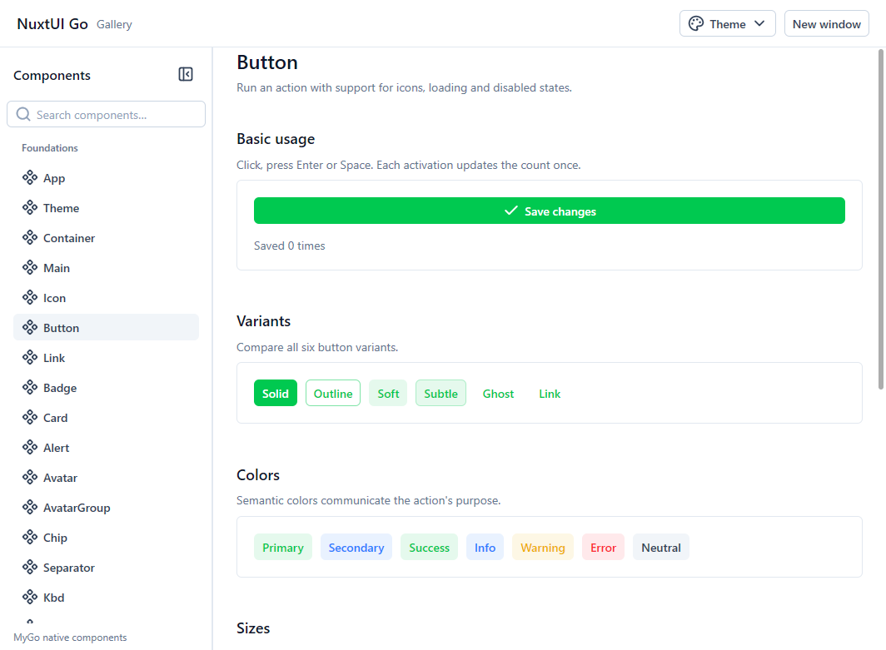

# NuxtUI Go

A Go component library for desktop user interfaces. NuxtUI Go is built on [MyGo](https://github.com/egoist/mygo) and provides buttons, inputs, forms, tables, trees, charts, and application layouts styled after Nuxt UI v4.

Native apps do not depend on Vue, Node.js, or a WebView. Components support light, dark, and system appearance, and ship with English and Simplified Chinese messages, 26 color palettes, and 2,015 Lucide icons that are compiled in only when used.

**New to the library? Start with the minimal app below.** To see the components first, [run the Gallery](#run-the-examples). To add components to an existing app, go to the [component guide](docs/README.md).



## Getting started

You need **Go 1.27.3 or later** and a desktop graphics session. Build with `CGO_ENABLED=0`. Windows, Linux, and macOS have different levels of verification; see [Requirements and platforms](docs/compatibility.md#requirements-and-platforms).

### 1. Create a project

```sh
mkdir nuxt-ui-demo
cd nuxt-ui-demo
go mod init example.com/nuxt-ui-demo
go get github.com/josexy/nuxt-ui-go@latest
```

The module path is `github.com/josexy/nuxt-ui-go` and the package name is `nui`. The Go and MyGo versions this repository uses are listed in [go.mod](go.mod).

### 2. Create main.go

This program opens a window and increments a counter each time you click Save. It matches the repository's [minimal example](examples/minimal/main.go).

```go
package main

import (
	"log"

	"github.com/egoist/mygo"
	"github.com/egoist/mygo/ui"
	nui "github.com/josexy/nuxt-ui-go"
)

func main() {
	config := nui.DefaultApp()
	count := 0
	mygo.App.SetLanguages(nui.SupportedLocales()...)
	mygo.App.WhenReady(func() {
		mygo.NewWindow(mygo.WindowOptions{
			Title: "NuxtUI Go minimal", Width: 480, Height: 240,
			Content: ui.View(func(c *ui.Context) {
				theme := nui.App(c, config)
				nui.Container(c, theme, nui.ContainerOptions{}, func() {
					ui.Textf(c, "Saved %d times", count)
					nui.Button(c.Key("save"), theme, "Save", nui.ButtonOptions{}).
						OnClick(func() { count++ })
				}).PaddingY(24)
			}),
		})
	})
	if err := mygo.App.Run(); err != nil {
		log.Fatal(err)
	}
}
```

Three things to note:

- `count` and `config` live outside the view function, so they keep their values when the UI rebuilds.
- `nui.App(c, config)` prepares the theme for the current window. Pass the returned `theme` to every component.
- `OnClick` changes the data after a click, and MyGo rebuilds the UI from the new data.

### 3. Run the app

Windows PowerShell:

```powershell
go mod tidy
$env:CGO_ENABLED = '0'
go run .
```

Linux or macOS shell:

```sh
go mod tidy
CGO_ENABLED=0 go run .
```

Once the window opens, read [How component calls work](docs/README.md#how-component-calls-work) to add inputs and other controls.

## Run the examples

Run these commands from the **repository root**. First set `CGO_ENABLED` to `0`: use `$env:CGO_ENABLED = '0'` in PowerShell or `export CGO_ENABLED=0` in a Linux or macOS shell.

| What you want to see | Command | Source |
| --- | --- | --- |
| Every component, theme, and interaction | `go run ./examples/gallery` | [Gallery](examples/gallery/) |
| The smallest window, theme, and button setup | `go run ./examples/minimal` | [Minimal app](examples/minimal/main.go) |
| Form validation, edit dialogs, menus, and notifications | `go run ./examples/settings` | [Settings](examples/settings/) |
| Search, filters, pagination, tables, and trees | `go run ./examples/data-browser` | [Data browser](examples/data-browser/) |

## Documentation by task

| Task | Document |
| --- | --- |
| Find a component and learn the basic state and callback patterns | [Component guide](docs/README.md) |
| Change colors, font sizes, spacing, or a component's style | [Themes and basic components](docs/foundations.md) |
| Look up defaults, or configure multi-select, orientation, loading states, or overlays | [Options and defaults](docs/options.md) |
| Switch languages, override built-in messages, or use icons | [Internationalization](docs/i18n.md), [Lucide icons](icons/lucide/README.md) |
| Check platform support, known issues, and version changes | [Compatibility and known limitations](docs/compatibility.md), [Changelog](CHANGELOG.md) |

The component website covers 73 components and layouts in English and Chinese, with live Go/WASM previews, option editors, and complete Go programs you can copy. To run it locally, install the dependencies as described in [Local development](website/README.md#local-development) and run `task website:dev`. The same document explains static builds and GitHub Pages publishing.

## Agent skill

Coding agents can use the [nuxt-ui-go skill](.agents/skills/nuxt-ui-go/SKILL.md). It has one reference per component with exact Go signatures, options, pitfalls and a runnable example, plus app patterns. Agents that read `.agents/skills/` find it in this repository automatically. To use it in your own app, copy the `.agents/skills/nuxt-ui-go` folder into the directory where your agent loads skills.

## Contributing

Install [Task](https://taskfile.dev/docs/installation), then run `task` in the repository root to list the available commands. `task verify` runs the Windows or Linux verification script, which checks formatting, tests, lifecycle rules, and cross-platform builds.

All commands are defined in [Taskfile.yml](Taskfile.yml), and the CI configuration is in [check.yml](.github/workflows/check.yml). Working on the website also requires Node.js and pnpm; ordinary Go apps do not need them.

## License

This project is released under the [MIT License](LICENSE). Sources and licenses for Nuxt UI, Lucide/Feather, Tailwind CSS, and MyGo are listed in the [third-party notices](THIRD_PARTY_NOTICES.md).
